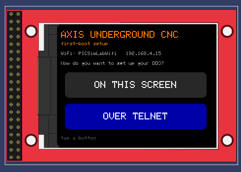

# CYD-3000 GHOSTBOARD

**The ESP32 Cheap Yellow Display that isn't there.**

<p align="center"><a href="https://buymeacoffee.com/revjmoney"></a></p>

An emulated ESP32-2432S028 "Cheap Yellow Display" on your Linux desktop: the 320x240 ILI9341 screen, the
XPT2046 touch controller, the SD card slot, the serial port and Wi-Fi, all running real ESP32 firmware images.
No board, no USB cable, no soldering iron. Flash it, boot it, telnet into it.

Built by Rev. J. Money to run **[AXIS Micro BBS](https://github.com/revjmoney/axis-bbs)** without the hardware,
and to turn a spare PC into one more node of an AXIS BBS. **It was built for AXIS.** Other CYD firmware may or
may not work: if yours does (or doesn't), open an issue and say what you ran.

```
 ┌──────────────────────────────────────────────┐
 │  CYD-3000 GHOSTBOARD  ·  ESP32 @ 240 MHz x2  │
 │  4 MB QIO flash · ILI9341 · XPT2046 · SD     │
 │  Wi-Fi (emulated) · UART 115200 · telnet:2323│
 └──────────────────────────────────────────────┘
```

<p align="center"><br><sub>AXIS Micro BBS 0.53 on the GHOSTBOARD, first boot, joined to the emulated Wi-Fi</sub></p>

## What's inside

GHOSTBOARD is **[PICSimLab](https://github.com/lcgamboa/picsimlab) 0.9.3** by Luis Claudio Gamboa Lopes, driving
his **[ESP32 QEMU](https://github.com/lcgamboa/qemu)** (Espressif's ESP32 machine with emulated Wi-Fi), plus the
fixes it took to run a real dual-core QIO firmware all day:

| Fix | Without it |
| --- | --- |
| GigaDevice flash quad-enable | QIO firmware boot-loops: `assert failed: do_core_init ... flash_ret == ESP_OK` |
| SPI user-mode dummy cycles | every flash read through the driver comes back shifted: NVS wiped each boot (saved Wi-Fi lost), LittleFS won't mount or format |
| Cache regions stay mapped | about 11 ms per flash call (the whole memory map rebuilt on every cache toggle): file saves crawl, AXIS cluster nodes drop out |
| ILI9341 row flip | the screen is mirrored left to right |
| GPIO32-39 outputs and input directions | the touch controller never hears the firmware (its MOSI and CS are GPIO32/33) and the firmware never hears it back |
| CYD touch: timing, range, release, pressure | taps read doubled, land mirrored, the panel looks held down forever, and the right half of the screen never counts |

The whole story, with how each one was found: [docs/HOW-IT-WORKS.md](docs/HOW-IT-WORKS.md).

## Quick start

Linux x86_64 with a desktop (tested on Ubuntu 24.04 GNOME, Wayland via Xwayland). No root needed to run it.

### Ready to run (release download)

```bash
tar -xJf cyd-3000-ghostboard-0.1.0-linux-x86_64.tar.xz
cd cyd-3000-ghostboard-0.1.0
./install.sh                         # puts PICSimLab + the patched QEMU in ~/.ghostboard
```

Each release also carries the exact PICSimLab and QEMU source it was built from (GPL-2.0), and a
`SOURCES.txt` saying how.

### Or build it from source

```bash
git clone https://github.com/revjmoney/cyd-3000-ghostboard
cd cyd-3000-ghostboard
scripts/setup.sh                     # downloads PICSimLab 0.9.3, builds the patched QEMU (about 8 minutes)
```

`setup.sh` tells you which packages are missing (Ubuntu: `git build-essential ninja-build python3 python3-venv
perl flex bison pkg-config curl libglib2.0-dev libpixman-1-dev libslirp-dev libgcrypt20-dev`). Running it again
skips everything already done.

### Flash and boot

```bash
# separate files from a PlatformIO / Arduino build:
scripts/flash-firmware --bootloader bootloader.bin --partitions partitions.bin --otadata boot_app0.bin --app firmware.bin
# or one merged 4 MB image (esptool merge_bin --fill-flash-size 4MB ..., or a flash dump):
scripts/flash-firmware merged-4MB.bin

scripts/ghostboard --fresh           # the board opens on your desktop
tail -f ~/.ghostboard/serial.log     # the serial port
telnet localhost 2323                # the board's port 23
scripts/ghostboard-stop              # saves what the firmware wrote to flash, then stops
```

`scripts/ghostboard` (without `--fresh`) keeps what the running firmware saved: settings, Wi-Fi, files in
internal flash. Click the screen to touch it. Each start opens PICSimLab with the board already wired:

| Part | ESP32 pins |
| --- | --- |
| ILI9341 LCD (SPI) | CLK 14, MOSI 13, DC 2, CS 15 |
| XPT2046 touch (bit-banged) | CLK 25, MOSI 32, MISO 39, CS 33 |
| SD card (SPI) | MOSI 23, SCK 18, CS 5, MISO 19 (`~/.ghostboard/sd.img`, 256 MB FAT32) |
| Serial terminal | TX 1, RX 3 at 115200 |

### Tools

| Tool | Does |
| --- | --- |
| `tools/nvs_wifi.py` | preloads the emulated Wi-Fi (open network `PICSimLabWifi`) into NVS, so firmware joins without touch |
| `tools/sd_fill.py DIR` | copies a folder tree onto the SD card image (needs `pyfatfs`) |
| `tools/tap.py X Y` | taps the screen at the firmware's coordinates, for scripts and tests (a person just clicks) |
| `tools/lfd3k_bridge.py` | an [LRA FLOWTRON DATAMASTER 3000 SERIAL MODEM - LFD3K-SM](https://github.com/revjmoney/lfd3k-sm) on USB answers radio calls into the board |

To type into the board's serial console from a script, use PICSimLab's remote control on port 5000: send
`set part[02].in[01] YOUR COMMAND` (part 02 is the serial terminal).

If GHOSTBOARD saved you a board (or a weekend), keep the coffee coming:

<p align="center"><a href="https://buymeacoffee.com/revjmoney"></a></p>

## Running AXIS

[docs/AXIS.md](docs/AXIS.md): flash an AXIS build, preload Wi-Fi, set it up on the screen or over telnet, fill the SD card with
themes and menus, join an AXIS cluster as a node, and take LoRa radio calls through an LFD3K-SM modem.

## Status

| | |
| --- | --- |
| Boots dual-core QIO ESP32 firmware | yes |
| Emulated Wi-Fi, NTP, telnet in through the forward | yes |
| NVS and LittleFS in internal flash, kept across restarts | yes |
| SD card | yes |
| LCD | yes |
| Touch | yes: click the screen (tested across the whole screen on AXIS's buttons and on-screen keyboard) |
| AXIS cluster node next to real CYD boards | yes |
| Speed | slower than a real board; fine for menus, telnet, files and radio calls |

## Credits and license

GHOSTBOARD's own scripts, tools and patches: GPL-2.0, Copyright (C) 2026 Rev. J. Money. PICSimLab and QEMU keep
their own copyrights and licenses (GPL-2.0); see [NOTICE](NOTICE). Huge thanks to Luis Claudio Gamboa Lopes for
PICSimLab and the ESP32 QEMU work it builds on, and to Espressif and the QEMU project.

ESP32 is a trademark of Espressif Systems. Not affiliated with any CYD vendor.

<p align="center"><a href="https://buymeacoffee.com/revjmoney"></a></p>
<p align="center"><b>Built by Rev. J. Money</b> · fueled by coffee · <a href="https://buymeacoffee.com/revjmoney">buymeacoffee.com/revjmoney</a></p>
